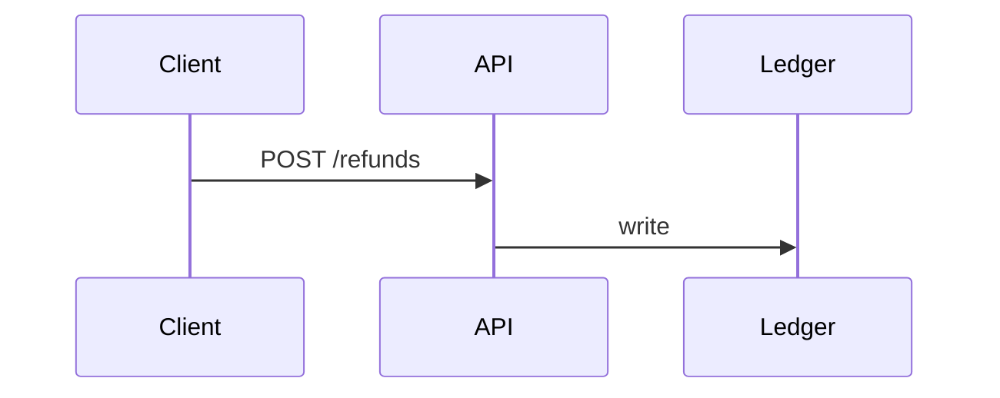

<h3>PR Summary by Qodo</h3>

Make refunds idempotent

<code>✨ Enhancement</code> <code>🧪 Tests</code> <code>🕐 10-20 Minutes</code>

AI Description

><pre>
>• Add an idempotency key to refunds.
>• Test duplicate refund requests.
></pre>

Diagram

High-Level Assessment

>Reuse the existing idempotency table.

